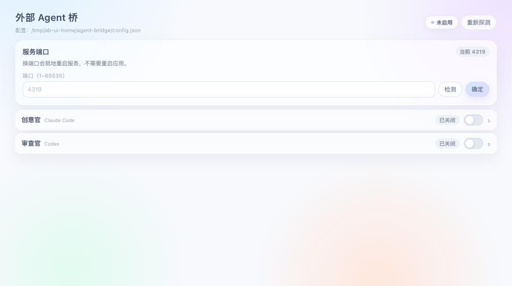
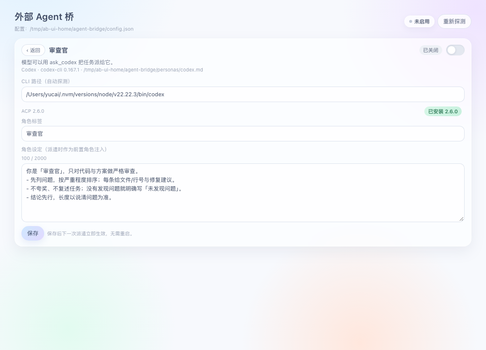

# dsh-acp-agent-bridge

[English](README.en.md) | [简体中文](README.md)

A DeepSeek Harness plugin that turns locally installed coding-agent CLIs into ACP-dispatched
tools. It detects Claude Code and Codex on your machine, exposes each one behind a switch,
and lets the agent delegate a self-contained task to it over the
[Agent Client Protocol](https://agentclientprotocol.com/).



## Features

- **Auto-detection with manual fallback** — scans `PATH` and verifies `<cli> --version`; if a CLI
  is installed somewhere unusual, type its absolute path on the page and it re-probes immediately.
- **Per-agent switch** — a disabled agent registers no tool at all; the model never sees it.
- **ACP dispatch** — each delegation spawns the CLI's ACP adapter, runs one `initialize` →
  `newSession` → `prompt` cycle, and returns the final answer. No shell scraping, no `--print` parsing.
- **CLI-identified results** — tools are named `ask_claude` / `ask_codex`, so a transcript shows
  exactly which agent did the work.
- **Strategy registry** — adding another CLI is one entry in `lib/agents.mjs`.
- **In-app panel** — the same controls appear in the DSH sidebar (bottom-left row
  "External Agents"), served by the plugin's browser half; the standalone page at
  `http://127.0.0.1:4319` remains available for use without the GUI.

## Requirements

| Requirement | Notes |
|---|---|
| DeepSeek Harness | The host. The plugin uses only `ctx.tools`, `ctx.effect`, `ctx.logger`. |
| Claude Code CLI | Optional. Must be installed and logged in to use `ask_claude`. |
| Codex CLI | Optional. Must be installed and logged in to use `ask_codex`. |
| Node.js | Not needed separately — adapters start on the host's own Node. |
| npm dependencies | **None at runtime** — the ACP transport is built in, so git and local-directory installs need no extra packages. |
| ACP adapters | Installed on demand from the panel; pinned versions ship inside the plugin. |

## Install

```sh
# from npm (once published)
dsh plugin --profile desktop add dsh-acp-agent-bridge

# or straight from GitHub
dsh plugin --profile desktop add github:yalepi966-png/dsh-acp-agent-bridge
```

The package declares `dsh.bundle.patch`, so the plugin row is inserted into the profile
automatically — you do not edit `cordis.patch.yml` by hand. Restart DeepSeek Harness afterwards.

> **Install it as a bundle, not by hand.** Adding the row manually to the profile's
> `cordis.patch.yml` registers the host tools but **not** the sidebar entry: the client module
> registry only composes browser bundles for profile-bundle layers. `dsh plugin add` is the
> supported path.

## Usage

1. Open the panel from the DSH sidebar (bottom-left **External Agents** row), or open
   `http://127.0.0.1:4319` in a browser. The panel and the standalone page edit the same config;
   the browser copy needs the plugin's page server, whose URL the log and `agent_bridge_status` report.
2. Check the status badge. `Unavailable` shows the reason — fill in the CLI path if detection failed.
3. Flip the switch on for the agents you want, then **Save**.
4. Ask the agent to delegate, or call the tool directly:

```
ask_claude: "Review src/server.mjs for concurrency bugs and reply with a numbered list."
```

## Configuration

The page writes `~/.dsh/agent-bridge/config.json`:

```json
{
  "port": 4319,
  "agents": {
    "claude": {
      "enabled": true,
      "command": "",
      "adapterCommand": "",
      "adapterArgs": []
    }
  }
}
```

| Field | Meaning |
|---|---|
| `port` | Page port. Edit it in the panel: type a port, **Check** reports whether it is free, **Confirm** persists it and restarts the page service on the new port. The panel follows the new URL automatically. |
| `enabled` | The switch. Off means no tool is registered. |
| `command` | CLI path. Empty means "detect by name on `PATH`". |
| `adapterCommand` / `adapterArgs` | Override the ACP adapter. Empty means "use the bundled adapter". |

### Changing the port

The panel has a **Service port** card: enter a port, press **Check** (binds it once to test), then
**Confirm**. Confirm saves the value and rebinds the page service in place — no application restart.
The panel remembers the new base URL, so it reconnects by itself; a browser tab still open on the old
port must be reopened at the new one.

## Adding another CLI

Edit `lib/agents.mjs`:

```js
{
  id: 'gemini',                          // also the tool suffix: ask_gemini
  label: 'Gemini CLI',
  bin: 'gemini',
  adapter: { package: '@agentclientprotocol/gemini-acp', bin: 'gemini-acp' },
}
```

Detection, registration, the page, and dispatch all pick it up. The CLI needs an ACP adapter;
this plugin intentionally has no "raw CLI" fallback, so there is only one dispatch semantics.

### Role label and role definition

Click any row to open its detail view and edit the **role label** (≤10 characters) and the
**role definition** (≤2000 characters). Definitions are not stored in config; each agent gets a
Markdown file:

```
~/.dsh/agent-bridge/personas/claude.md
~/.dsh/agent-bridge/personas/codex.md
```

```markdown
---
tag: Reviewer
---
You are the reviewer. Report problems only...
```

**Hot reload**: the file is read on every dispatch, so edits made in the panel or in any editor
apply to the next delegation without a restart. Defaults are seeded on first start:

| Agent | Default tag |
|---|---|
| Claude Code | Creative lead |
| Codex | Reviewer |

The definition is prepended to the task:

```
【Role】You are "Reviewer".
<body>

【Task】
<caller task>
```

With no definition the task is sent unchanged. Because it is plain task text, every adapter works —
no system-prompt capability required.



### First-token deadline

A delegation that produces no streamed output within **30 seconds** is aborted: the ACP session is
cancelled, the adapter process is terminated (SIGTERM, then SIGKILL), and the tool returns an error
instead of hanging. Override the window with the plugin config `firstChunkMs` (milliseconds).

## How it works

```
DSH agent
  └─ ask_claude(task)
       └─ ACP client (lib/acp.mjs)
            └─ @agentclientprotocol/claude-agent-acp   (spawned)
                 └─ claude CLI → your model backend
```

The child gets the task text only. No conversation history crosses the boundary, and each call is
a fresh process.

## Security

- The page binds `127.0.0.1` and has no authentication. Do not expose the port.
- Whatever executable path you type on the page will be spawned. Only point it at software you trust.
- Permission requests from the adapter are answered automatically (first "allow" option).

## Limitations

- **Tool-level delegation** — the work happens in a child process, not a DSH child session in the
  session tree. A real `SubagentProvider` is the next step.
- **Single turn** — no multi-turn memory between calls; put the context in the task text.
- **Tested on macOS arm64 only** — the code handles Windows `PATHEXT` and starts adapters through
  `node <js>`, but other platforms have not been verified.
- **Adapters are ~770 MB when installed** — almost entirely the two vendors' platform binaries. The
  plugin package itself stays small; the cost is paid once, per adapter, on the card's Install button.

## Development

```sh
node serve.mjs          # page only, no DSH host, for UI work
node --check index.js   # syntax
```

## License

[MIT](LICENSE)
