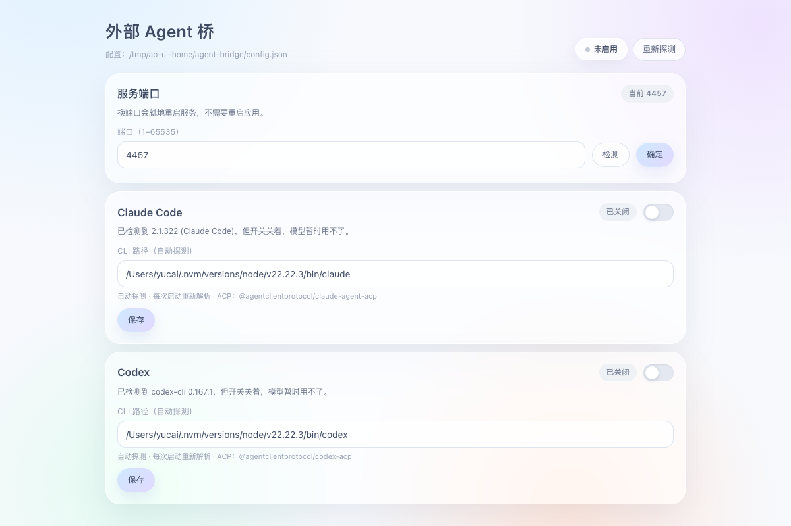

# dsh-acp-agent-bridge

[English](README.en.md) | [简体中文](README.md)

一个 DeepSeek Harness 插件：把本机安装的编程 Agent CLI 变成可被 ACP 派遣的工具。自动探测
Claude Code 与 Codex，每个都用一个开关控制，打开后 Agent 就能把一个自包含任务交给它执行。



## 特性

- **自动探测 + 手动兜底**：扫描 `PATH` 并执行 `<cli> --version` 验证；装在奇怪位置时，在页面上填
  绝对路径即可，保存后立即重探。
- **每个 Agent 一个开关**：关闭时不注册任何工具，模型完全看不到。
- **ACP 派遣**：每次调用会 spawn 对应 CLI 的 ACP 适配器，走一遍
  `initialize → newSession → prompt`，直接拿最终回答，不解析 `--print` 的文本。
- **按 CLI 名识别**：工具名是 `ask_claude` / `ask_codex`，会话记录里一眼看出派给了谁。
- **策略表**：新增一个 CLI 只需在 `lib/agents.mjs` 加一项。
- **应用内面板**：同一套控件也挂在 DSH 左侧栏底部（「外部 Agent」一行），由插件的浏览器端提供；
  独立页面 `http://127.0.0.1:4319` 保留，用于不开 GUI 的场景。

## 依赖

| 依赖 | 说明 |
|---|---|
| DeepSeek Harness | 宿主；插件只用 `ctx.tools` / `ctx.effect` / `ctx.logger` |
| Claude Code CLI | 可选；要用 `ask_claude` 就必须装好并登录 |
| Codex CLI | 可选；要用 `ask_codex` 就必须装好并登录 |
| Node.js | 不需要单独装，适配器用宿主自带 Node 启动 |
| ACP 适配器 | 在面板里按需安装；版本由插件内部固定 |
| npm 依赖 | **零运行时依赖**：ACP 传输层内置，git / 本地目录安装都不需要额外装包 |

## 安装

```sh
# 从 npm（发布后）
dsh plugin --profile desktop add dsh-acp-agent-bridge

# 或直接从 GitHub 装
dsh plugin --profile desktop add github:yalepi966-png/dsh-acp-agent-bridge
```

包内声明了 `dsh.bundle.patch`，`dsh plugin add` 会自动把插件行插进 profile 组合，**不用手改
`cordis.patch.yml`**。装完重启 DeepSeek Harness。

> **必须用 bundle 方式安装，不要手动插条目。** 手写进 profile 的 `cordis.patch.yml` 只会注册宿主
> 工具，**侧栏入口不会出现**：客户端模块注册表只为 profile bundle 层组合浏览器 bundle。
> `dsh plugin add` 是唯一受支持的路径。

## 使用

1. 从 DSH 左侧栏底部点「外部 Agent」打开面板，或在浏览器打开 `http://127.0.0.1:4319`。
   两个入口改的是同一份配置；浏览器入口依赖插件起的页面服务，端口被占会自动换一个，
   实际地址在日志里，也会由 `agent_bridge_status` 工具返回。
2. 看状态徽标。`不可用` 会写明原因，探测失败就在路径框里填绝对路径。
3. 打开需要的开关，点 **保存**。
4. 让 Agent 派遣，或直接调用：

```
ask_claude: "审一下 src/server.mjs 的并发问题，用编号列表回答。"
```

## 配置

页面写入 `~/.dsh/agent-bridge/config.json`：

```json
{
  "port": 4319,
  "agents": {
    "claude": {
      "enabled": true,
      "command": "",
      "adapterCommand": "",
      "adapterArgs": []
    }
  }
}
```

| 字段 | 含义 |
|---|---|
| `port` | 页面端口。在面板里改：填端口 → **检测** 报告是否空闲 → **确定** 保存并在新端口重启页面服务，面板会自动跟过去 |
| `enabled` | 开关；关闭即不注册工具 |
| `command` | CLI 路径；留空表示按名字在 `PATH` 上探测 |
| `adapterCommand` / `adapterArgs` | 覆盖 ACP 适配器；留空表示用包内自带的 |

### 修改端口

面板顶部有一张「服务端口」卡：填端口 → 点 **检测**（会真的试绑一次）→ 点 **确定**。确定会保存配置并在
原插件内重启页面服务，不需要重启应用。面板会记住新的地址自动重连；如果旧端口的浏览器标签页还开着，
需要在新端口重新打开。

## 新增一个 CLI

编辑 `lib/agents.mjs`：

```js
{
  id: 'gemini',                          // 同时是工具名后缀 ask_gemini
  label: 'Gemini CLI',
  bin: 'gemini',
  adapter: { package: '@agentclientprotocol/gemini-acp', bin: 'gemini-acp' },
}
```

探测、注册、页面、派遣都会自动跟上。前提是该 CLI 有 ACP 适配器；本插件故意不做“直调 CLI”兜底，
避免两套派遣语义并存。

### 首字超时

一次派遣如果 **30 秒**内没有任何流式输出，会被中止：取消 ACP 会话、终止适配器进程（SIGTERM，
1.5 秒后 SIGKILL），工具返回错误而不是一直挂着。窗口可以用插件配置 `firstChunkMs`（毫秒）调整。

## 工作原理

```
DSH Agent
  └─ ask_claude(task)
       └─ ACP 客户端 (lib/acp.mjs)
            └─ @agentclientprotocol/claude-agent-acp   (子进程)
                 └─ claude CLI → 你的模型后端
```

子进程只拿到任务文本，不继承父会话历史；每次调用都是一个全新进程。

## 安全

- 页面只绑 `127.0.0.1` 且没有鉴权，不要把端口暴露出去。
- 你在页面上填的任意可执行路径都会被启动，只指向你信任的程序。
- 适配器发来的权限请求会被自动批准（选第一个 allow 选项）。

## 限制

- **工具级派遣**：任务跑在子进程里，不是会话树中的 child session。真正的
  `SubagentProvider` 是下一步。
- **单轮无状态**：调用之间没有多轮记忆，上下文要写进任务文本。
- **只在 macOS arm64 上测过**：代码处理了 Windows 的 `PATHEXT`，适配器也统一用
  `node <js>` 启动，但其他平台没有实机验证。
- **装好适配器后约 770MB**：几乎全是两家的平台二进制。插件包本身很小，这部分只在点“安装”时
  按需下载，装一次即可。

## 开发

```sh
node serve.mjs          # 只起页面，不需要 DSH 宿主，方便调 UI
node --check index.js   # 语法检查
```

## 许可证

[MIT](LICENSE)
